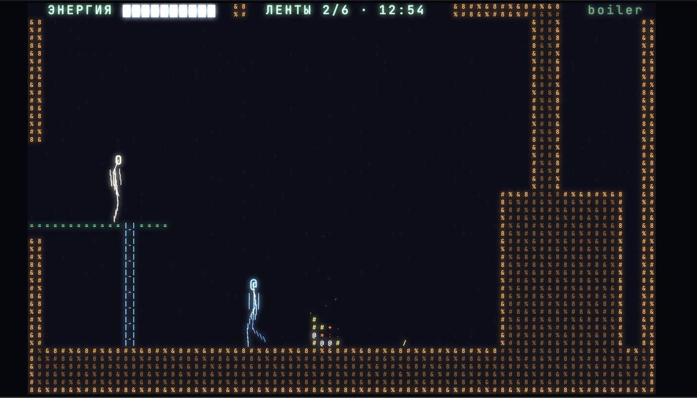
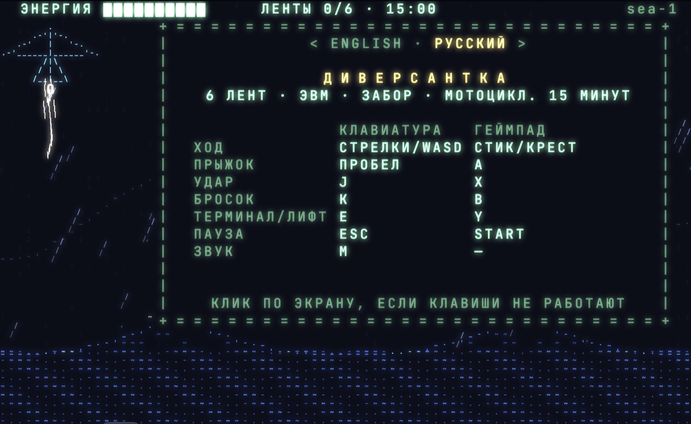

<div align="center">

# ДИВЕРСАНТКА

**ASCII-платформер со светящимися символами — оммаж Saboteur II**

[**▶ Играть в браузере**](https://art-ps.github.io/diversantka/)



</div>

Ночь, шторм, дельтаплан над морем. Героиня отцепляется над крышей базы, и с этой секунды идёт таймер:
найти шесть перфолент с кодом, вставить их в терминалы, обесточить забор и уйти на мотоцикле из гаража.
Стены, персонажи, огонь и дождь — всё нарисовано буквами и знаками моноширинного шрифта.

## Что внутри

- **Около сорока экранов**: крыша, корпус, подвал, котельная, шахта лифта, пещеры, река, лес, гараж.
- **Бой**: рука, нога, удар в прыжке, бросок ножа или камня. Андроиды мечут ножи на уровне головы — под ними можно присесть. Собака низкая: рука проходит над ней, бить ногой.
- **Ловушки**: огнемёты в стенах, огненные ямы, шипы, вода.
- **Лифт** на несколько этажей, вызов кнопкой.
- **Секретная комната** — найдёшь, отметят в итогах миссии.
- **Карта на паузе** — уже пройденные экраны.
- **Звук** синтезируется на лету, записанных файлов нет.
- **Русский и English** — выбор на стартовом экране.

## Управление



Игра стартует с паузы: стрелками выбираешь язык, Пробел или A — полёт.

| Действие | Клавиатура | Геймпад |
|---|---|---|
| Ходьба, присед, лестницы | стрелки / WASD | стик, крестовина |
| Прыжок · отцепиться от дельтаплана | Пробел | A / ✕ |
| Удар (вверх + удар — нога) | J | X / □ |
| Подобрать / бросить | K | B / ○ |
| Терминал, кнопка лифта | E | Y / △ |
| Пауза и карта | Esc | Start |
| Свечение · полный экран · звук | B · F · M | — |

Нужна клавиатура или геймпад — на телефоне не поиграть.

## Как устроено

- **TypeScript + WebGL2**, без игровых движков и рантайм-зависимостей. Каждый кадр — сетка символов, которую рисует шейдер с bloom, как у старого монитора.
- **Персонажи — скелеты.** Точки и кости, каждая кость рисуется символом по своему наклону (`| / \ —`). Позы героини построены по базе захвата движений CMU.
- **Огонь** — порт классического doom-fire на поле жара; дым, помехи при гибели, рябь на воде и шторм пролога — отдельные эффекты.
- **Экраны — текстовые файлы** в [`src/world/rooms/`](src/world/rooms): карта рисуется символами, враги, предметы и выходы описаны в шапке.
- **Звук** — Web Audio: голоса синтезатора и фоновые звуки по месту.
- **Тесты** на vitest: логика боя и физики, проходимость каждого экрана (поиск пути с учётом урона) и прохождение всей миссии от крыши до мотоцикла.

## Запуск

```bash
npm install
npm run dev     # локальный сервер
npm test        # тесты
npm run build   # сборка в dist/
```

Push в `master` собирает игру и выкладывает на GitHub Pages.

## Благодарности

Из оригинальной Saboteur II (ZX Spectrum, 1987) не взято ничего — ни карты, ни графики, ни текстов; общие только жанр и настроение.

**Движения.** The data used in this project was obtained from mocap.cs.cmu.edu.
The database was created with funding from NSF EIA-0196217. BVH-конвертация — Bruce Hahne (cgspeed).
Исходные файлы в репозиторий не входят: `npm run mocap:fetch` скачивает их, `npm run mocap:build` собирает `anim/*.json`.

**Огонь и эффекты** — по мотивам анимаций [ascii.rest](https://github.com/bas3line/ascii) (© 2026 bas3line, MIT, см. [`third_party/ascii.rest-LICENSE`](third_party/ascii.rest-LICENSE)).

---

<div align="center">

Собрано с [Claude Code](https://claude.com/claude-code) · витрина [vibecoded.ru](https://vibecoded.ru)

</div>
